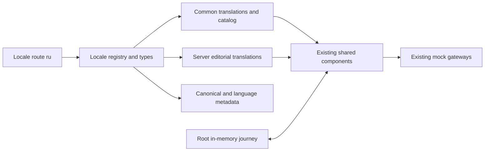

MODE: PLAN_AND_CREATE
ROLE: ARCH

# Russian Localization Task Spec

## Summary

Extend the current Paraguay Next prototype with complete Russian content and journeys, then publish the validated revision to the existing Firebase team preview. Tier S1 and publication to that preview are explicitly confirmed by the owner. Reuse the current Next.js App Router, React components, catalog, translation dictionaries, in-memory journey state and mock gateways. This is a locale extension, not a redesign or business launch. Baseline: `8a7ff4da349e1d727f2c3c00e14f7f36e53a24fc`.

## Requirements

- Make every current public route and every visible journey state available at the equivalent `/ru` path. Keep existing route suffixes and technical identifiers unchanged.
- Register Russian as `ru`, native label `Русский`, formatting locale `ru-RU`, document direction `ltr` and Open Graph locale `ru_RU`.
- Translate navigation, accessibility labels, finder, catalog, pricing explanations, forms, validation, mock messages and receipts, editorial/service/guide/policy content, value proposition, qualified tax comparisons, metadata and share artwork.
- Preserve the exact meaning and qualifications of the canonical English content. Do not add a tax benefit, tax rate, eligibility promise, legal conclusion, support staffing claim or approved business fact.
- Keep provisional USD amounts, demo disclosures, mock-only integrations, noindex metadata/headers and the empty preview sitemap. Technical completeness does not approve a language or claim for business launch.
- Preserve selected service/package, campaign, family quote, finder origin and answers, private contact draft, accepted receipt and selected UTC appointment instant when switching languages, including Hebrew to Russian and back. Never put private fields in URLs or storage.
- Authored visible Russian wording must avoid hyphens, dash punctuation and decorative dash separators, matching the existing contract. Do not alter customer text, URLs, identifiers or ISO date data to enforce this.
- No stack changes, new internationalization dependency, currency conversion, separate Russian app, translated slugs, live provider activation, default-branch merge or changes to another Firebase project.

## Architecture

Retain the existing dependency direction: locale configuration and domain types feed catalog/content projection and presentation; the root journey provider owns state independently of route language. Common dictionaries remain client-safe, while long editorial dictionaries remain server-only. Missing messages and interpolation values continue to throw rather than silently render English.



### Relevant folder structure

No module boundary or folder reorganization is required. Paths below are the bounded implementation surface, not a new architecture:

```text
src/
  domain/types.ts                 Locale union and localized value contracts
  config/locales.ts              Supported language, name, format and direction
  config/routes.ts               Public locale projection and explicit localized records
  lib/i18n/common.ts             Client-safe dictionary registration
  lib/i18n/editorial.ts          Server-only dictionary registration
  content/translations/
    ru-common.json               New complete Russian common dictionary
    ru-editorial.json            New complete Russian editorial dictionary
scripts/render-social-assets.mjs Localized original artwork generation
public/                         Russian generated hero and social assets in existing locations
tests/unit/                     Locale, translation, metadata and content approval contracts
tests/e2e/                      Route parity, state preservation, responsive and accessibility checks
docs/                           This contract and small updates to existing reference docs
```

Existing components and runtime code need edits only if an explicit locale map or real Russian rendering failure requires them. Do not refactor adjacent code during this increment.

## API Contracts

| Interface | Russian extension | Preserved failure/compatibility behavior |
| --- | --- | --- |
| `Locale`, `supportedLocales`, `isLocale(value)` | Include exact lowercase `ru`; expose all six public languages | Unsupported locale values remain rejected; unknown route requests remain real 404 responses |
| `translate(locale, key, values?)`, `editorialText(locale, key, values?)` | Resolve the canonical English key to nonempty Russian text | Preserve exact named placeholders; missing message or parameter throws |
| `localized(key)`, `localizedList(keys)` | Include the Russian value through the existing registry | Catalog IDs, ordering, package scope and numerical prices unchanged |
| `routePath(locale, pageKey)` and page metadata | Equivalent `/ru` route, Russian metadata, self canonical, reciprocal six-language alternates and English `x-default` | Canonicals exclude query/fragment; internal fixture is not a public Russian route or alternate |
| Submission and analytics locale validation | Accept `ru` using the established locale contract | Existing payload schema, consent requirements, redaction, mock outcomes and status/error model unchanged |
| Language link and root journey provider | Change presentation/route locale without rebuilding state | Preserve safe URL context and private in-memory state; translating a receipt must not resubmit |

There is no new endpoint, provider contract, persisted data model or API version.

## Module Descriptions

- **Locale registry and types:** add Russian once to the public support contract; inspect explicit locale records in route fixtures and formatting/metadata tests. Runtime acceptance must not rely on an English fallback.
- **Translation dictionaries:** create Russian keys identical to the existing canonical key sets. At the inspected baseline the inventory contains 478 common and 530 editorial values; these are observations, not validation limits. Tests must compare the actual full key sets at the reviewed revision.
- **Catalog and commercial content:** reuse current translated projections. Preserve all exclusions, quote-only labels, provisional notices and conditional tax explanations, including the distinction between a foreign-owned US LLC and a Paraguay company.
- **Journey presentation:** reuse the current components and logical CSS. Russian is LTR; switching from Hebrew must update `lang` and `dir` without resetting the root provider. Use existing `Intl` formatters for the same USD values and selected instant.
- **Artwork and SEO:** generate `hero-editorial-ru.svg`, `og-default-ru.png`, `og-why-paraguay-ru.png`, `og-residency-cost-ru.png` and `og-family-relocation-ru.png` through the current generator. Preserve brand and image geometry. Check actual Cyrillic rendering, line wrapping and crop boundaries.
- **Publication controls:** Russian content completeness may join the existing complete-locale set; no professional, operator or locale publication approval may be invented or flipped to approved. Firebase publication remains a public noindex demo under the existing hosting contract.

## Tasks by Agent

- **FRONTEND:** own Russian dictionary content and registration, necessary explicit locale maps, generated assets and tests. Separate dictionary translation ownership from wiring/test ownership when running parallel work. Preserve concurrent edits and other locales. Use tests before code for acceptance and state transitions.
- **UX_UI:** inspect Cyrillic typography, language disclosure with six labels, hero/finder action placement, forms, errors, artwork and mobile wrapping. Reuse existing design tokens and patterns; propose only fixes needed for Russian usability.
- **BACKEND:** no new service or infrastructure implementation. Check existing submission/analytics acceptance through tests; change locale allowlists only if the registry does not already drive them.
- **VERIFIER:** prove representative Russian failures on the baseline and passes on the implemented revision; independently execute focused contracts and journeys and bind evidence to the source fingerprint/commit.
- **REVIEWER:** review all S1 severities, translation/key omissions, silently broadened approvals, altered legal meaning, privacy or duplicate submission regressions and accidental unrelated changes.
- **QA:** exercise local and hosted routes, Russian desktop/mobile/forms, HE/RU round trips, keyboard accessibility, no-JavaScript navigation, all mock outcomes, runtime errors and source-specific evidence. Do not describe automated or visual checks as native-speaker/legal review.
- **Root/SCRIBE:** root owns gates, deploy authorization and the exact Firebase target; SCRIBE owns issue bookkeeping from a concrete brief. No agent closes the issue or merges the default branch.

## Spec Updates

Update existing `docs/LOCALIZATION.md` and `docs/ROUTES_AND_SEO.md` to include Russian and six genuine equivalents; keep Hebrew direction requirements intact. Update language coverage in `docs/FIREBASE_HOSTING.md` and `docs/LAUNCH_CHECKLIST.md` where needed. Record native Russian/commercial review as unresolved launch input. Do not create new architecture or API documents for an unchanged architecture. GitHub issues remain the status tracker; factual evidence belongs in the task artifact directory.

## Tests

Write failing Russian acceptance tests before product changes. Extend existing independent acceptance lists explicitly; deriving every expectation from the modified registry alone cannot prove requested Russian coverage.

The known explicit test inventory is `tests/unit/translations.test.ts`, `tests/unit/locales.test.ts`, `tests/unit/seo.test.ts`, `tests/e2e/locales.spec.ts`, `tests/e2e/routes.spec.ts` and `tests/e2e/finder-placement.spec.ts`. Extend their locale/name/format/alternate expectations; existing tax/value-first tests already derive the locale registry. Russian number formatting may use nonbreaking spaces: compare the established `Intl` result instead of imposing English punctuation.

1. **Translation and locale unit contracts:** `ru` recognized; unsupported/case/path values rejected; complete common/editorial key parity; nonempty values; exact placeholder sets; no authored dash punctuation; missing Russian key/interpolation still fails loudly.
2. **Business and metadata contracts:** every current public route supports Russian; self canonical and all genuine alternates use configured origin and exclude query data; Open Graph locale is `ru_RU`; Russian remains noindex and fails business publication approval checks. Fixed/ranged prices remain the same USD values, and Russian slot formatting represents the same instant. Mock submission/receipt and privacy-safe analytics accept `ru`.
3. **Route/content browser matrix:** visit every public route in Russian with localized title, heading, accessible navigation and error-free rendering, plus existing-language regression. Exercise initial, selected, invalid, pending, mock failure, unavailable slot, accepted receipt and empty-receipt recovery states. Verify 404 for unsupported locale and unknown route, and the separate English-only internal fixture.
4. **State transitions:** EN to RU, HE to RU and RU to HE on the same route preserve service/package/campaign and provider state. Cover family finder result to booking, edited private draft and selected time, then an accepted receipt language round trip with no second submission. Inspect URLs and browser storage for absence of private data.
5. **UX and accessibility:** exercise RU at 320, 390, 768 and 1440 CSS pixels; include home, language disclosure, pricing, finder, book with errors, receipt, a service, guide, policy and campaign. Assert no unintended horizontal document overflow or clipped controls; inspect Cyrillic assets, keyboard focus, Escape behavior and field/error associations. Retain Hebrew RTL and long German-label regression. Direct no-JavaScript Russian navigation must work.

Run the repository commands: `npm test`, `npm run lint`, `npm run typecheck`, `npm run assets:social`, `npm run build`, `npm run test:e2e` and the existing accessibility suite as applicable. Add Russian-focused E2E coverage without dropping existing matrix entries; explicitly include it in mobile execution if relying on `playwright.config.ts` filename filters. No coverage percentage threshold is configured in the inspected Vitest configuration; do not invent one or claim unmeasured coverage.

## Implementation Roadmap

1. Pin baseline/source identity and save expected failing Russian tests. Use current canonical dictionary keys as the translation source.
2. Translate the full common and editorial dictionaries in parallel with isolated test/locale-wiring ownership. Integrate together so eager localized content construction cannot encounter missing Russian keys.
3. Register Russian, generate artwork and update reference documentation. Run focused tests, inspect assets, then run the complete local suite/build.
4. Complete independent verification, code review and manual responsive/accessibility QA within the existing three-cycle limit. Save factual evidence and scoped source identity.
5. Root publishes the exact validated source to the existing Firebase preview after rechecking its project/backend/origin from current configuration and provider state. Run the hosted suite using `E2E_BASE_URL` and the documented hosted timeout, plus Russian manual smoke/noindex/canonical checks. Record actual rollout identity and results in the issue; a local build alone does not prove successful publication.

## Potential Challenges

- **Cyrillic length and typography:** inspect real rendered text and all generated assets; do not reduce touch targets or hide essential qualifications to fit text.
- **Qualification loss in translation:** keep tax residency separate from immigration residency, and preserve conditional benefits, source categories and professional review limits. Review Russian text against complete canonical phrases rather than translating isolated labels.
- **Implicit five-locale assumptions:** search public registries, typed fixture records, test acceptance lists, assets and reference docs. Tests should exercise all routes rather than sample only the homepage.
- **Direction/state regression:** explicitly cross the Hebrew/Russian boundary without remounting the root provider, losing contact drafts or changing the selected instant.
- **Release safety:** retain demo configuration, current instance limits and mock gateways. Do not add Firebase resources, change billing/capacity or infer a deployment URL from naming conventions.

## Related Issue

[Russian localization and preview publication: issue #13](https://github.com/yonatan-levin/paraguay-residency-site/issues/13).

## Acceptance Criteria

1. Every real public route has a complete Russian equivalent; navigation remains Russian and contains the native language option. The internal fixture remains excluded from public alternatives.
2. Russian has no missing/empty/fallback translation gaps, unchanged placeholders and no prohibited dash punctuation in authored copy. Proper names and technical values remain intact.
3. Russian titles, descriptions, canonical and reciprocal language alternates are correct, generated assets render Cyrillic cleanly, and the preview retains noindex headers/metadata and an empty sitemap.
4. Package/campaign/family/finder context, private drafts, selected UTC instant and accepted receipt survive specified locale changes without duplicate submission or PII leakage.
5. Russian and existing languages pass the full unit/browser/build/static checks. Manual evidence covers the specified responsive widths, keyboard flow, actual Russian artwork and Hebrew RTL regression.
6. Review and independent verification identify no unresolved blocking defect. Factual QA distinguishes automated checks, manual checks, unavailable checks and native/professional reviews not performed.
7. The existing Firebase preview serves the validated Russian version and all prior locales, verified against its actual rollout and origin. Prices stay provisional, integrations mocked and business launch approvals pending. No default-branch merge or unrelated Firebase change occurs.

## Assumptions and Open Questions

Use standard written Russian for the broad Russian-speaking audience; nationality does not select a different catalog, legal treatment, currency or service promise. Native Russian wording review and qualified review of translated legal/commercial meaning remain launch inputs, not blockers for the authorized team demo. No further blocking product choice is identified in this bounded extension.

## Next Steps

FRONTEND implements this contract with UX_UI validation, then VERIFIER, REVIEWER and QA provide evidence to root. Root retains release and issue acceptance ownership.

HANDOFF_TO: FRONTEND
