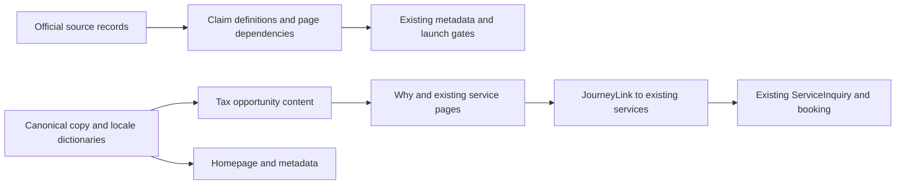

# Paraguay Next tax opportunities incremental specification

MODE: PLAN_AND_CREATE  
ROLE: ARCH  
Tier: S1 refinement of the approved value first update

## Summary

Make the existing website more commercially persuasive by explaining specific tax opportunities, who might benefit, and why discussing the right structure has value. Explain both a foreign owned US LLC and a company incorporated in Paraguay. Extend the current homepage, Why Paraguay and existing service pages; preserve the catalog, navigation, package context, translations and prototype boundaries. This document defines implementation behavior. Work status and review findings belong in the GitHub issue, not this document.

## Requirements

- Lead with the potential to retain more international income and build a practical base in Paraguay. Present the opportunity before the assistance offered by Paraguay Next.
- Explain a specific foreign dividend example, a conditional US federal income tax example, and the ordinary Paraguayan company tax position. Do not merge these into a worldwide zero tax promise.
- Keep all material conditions next to the relevant opportunity, visible in initial HTML. A footer disclaimer or an accordion cannot qualify an otherwise misleading headline.
- Keep the existing ten homepage sections and eight Why Paraguay sections in their existing order. Expand `financial-planning`; do not add another route or funnel.
- Preserve all service and package identifiers, provisional prices, booking access, selection precedence, campaign attribution, no JavaScript links, modified clicks and back/forward behavior.
- Translate every changed visible string and metadata value into ES, FR, DE and HE. Preserve Hebrew RTL. No decorative hyphen, en dash, em dash or Hebrew maqaf in authored visible copy; valid paths, source URLs and identifiers remain unchanged.
- Keep sources inspected and claims unapproved. No professional, operator or translation approval is inferred from research or implementation.
- No deployment, push, live integrations, payments, new dependencies, cloud configuration, runtime approval flag changes or catalog changes.

Out of scope: a tax savings calculator, eligibility questionnaire, personalized advice, a tax residency day threshold, complete treaty/CFC/exit tax analysis, state selection for a US LLC, a new bundled product, guaranteed incorporation or banking, and guaranteed savings.

## Architecture

Retain the existing Next.js server rendered content architecture. A small server only content module holds the new canonical English copy and localization accessors. One presentation component renders the relevant cases inside existing sections. The existing pure content review registry continues to own official source references and independent page claim dependencies. No state store, API or additional domain layer is needed.



Relevant file map, not a repository reorganization:

```text
src/
  content/
    tax-opportunities.ts          # New server only copy and case accessors
    value-first.ts                # Hero, tax benefit, motivation, outcome intros and FAQ
    content-review.ts             # Sources, professional claim sets and dependencies
    translations/
      {es,fr,de,he}-editorial.json # All new body content and source labels
      {es,fr,de,he}-common.json    # Changed metadata and shared short copy
  components/
    tax-opportunities.tsx         # New shared case/structure presentation
    why-paraguay.tsx              # Financial section integration
    content-pages.tsx            # Existing tax and company service integration
    home.tsx                     # Only if existing composition needs copy wiring
  config/routes.ts               # Titles and descriptions, routes unchanged
  app/globals.css                # Only scoped responsive styles if needed
tests/
  unit/content-review.test.ts    # New source/dependency failure cases
  unit/value-first.test.ts       # Existing content/journey contract regression
  e2e/tax-opportunities.spec.ts   # New locale, content and journey checks
docs/
  TAX_OPPORTUNITIES_SPEC.md       # This design and research boundary
  DECISIONS.md                   # Small durable decision additions
  LAUNCH_CHECKLIST.md            # Actual new professional review inputs
artifacts/tax-opportunities/     # Before/after evidence, separate from prior evidence
```

Use the existing stylesheet path if different at execution time. This spec author owns only this Markdown file; the main agent assigns all implementation files exclusively.

### Content and visual contract

Keep the current visual tokens, typography, buttons, section spacing and artwork. Tax cases use ordinary headings, paragraphs and lists. The two structures sit side by side where readable and stack on mobile, with no horizontal comparison table or fixed card height. A number such as 0% is never a detached badge: the tax, jurisdiction and income scope must remain in the same heading or immediately attached sentence.

Within `financial-planning`, render in this reading order:

1. Opportunity introduction and concrete personal foreign dividend case.
2. Two structures: US LLC and Paraguay company, each with intended use, tax opportunity, conditions and continuing obligations.
3. A concrete counterexample: performing services from Paraguay for a foreign client does not make the income foreign source merely because invoices or payments use a US LLC.
4. A concise explanation that immigration permission, tax residence and obligations in other countries are separate questions.
5. Informational links to `tax-planning`, `company-formation/us`, `company-formation/paraguay` and the existing budget section. Retain direct package and consultation access already present elsewhere.

Do not put `ServiceInquiry` in Why Paraguay. Informational links use `JourneyLink` and preserve the selected package even when the destination is another service. Only an explicit inquiry on an existing service page changes service context under the established compatibility contract.

## Research boundary and approved drafting direction

Sources below were inspected in the research workflow on 2026-09-26. They support a draft for professional review, not individual advice or approval to launch. Source labels must identify the authority and subject, and link directly to the supporting official page. Retain inspection provenance in `regulatorySources`.

| Claim | Supported content | Boundary |
|---|---|---|
| Personal foreign dividends | DNIT's nonbinding consultation 380 concludes that the foreign dividends in the submitted facts were outside Paraguayan national taxes because the source was foreign. | Attribute the example and its fact specific, nonbinding nature. Do not classify a US LLC distribution as a foreign dividend automatically. The page may describe a potential absence of Paraguayan personal income tax on qualifying foreign dividends, not a statutory universal 0% rate. |
| US LLC federal treatment | A single member LLC normally has disregarded federal income tax treatment unless it elects corporate treatment. For a nonresident alien owner, foreign source income that is not effectively connected with a US business may fall outside US federal income tax. | Exclude US citizens and US tax residents from this illustrative scenario. Explain that treatment follows the owner; the LLC is not an exemption. Do not imply no state taxes, withholding, other countries' taxes or filing obligations. |
| Service income source | Where services are physically performed generally determines the US source. Paraguayan personal source rules also include activities performed in Paraguay. | A US customer, foreign payer, foreign bank account or US LLC is insufficient to establish a foreign source under Paraguayan rules. Services performed from Paraguay are the required counterexample. |
| Paraguayan company | EAS and SRL are Paraguayan company forms, distinct from a US LLC. Ordinary IRE is 10% of net taxable income. | This is not an all in tax rate. Dividend taxes, VAT and reporting may apply. Article 6 has specific foreign income rules for IRE taxpayers, so foreign customers or foreign activity do not establish a blanket exemption. |
| Residence boundary | Tax residence certification is a separate DNIT process. US citizens/residents can remain subject to US taxation on worldwide income. | A residence permit does not by itself resolve tax residence, income source, departure from a former tax system or continuing obligations elsewhere. Do not invent a universal presence threshold or automatic tax residence transfer. |

Official research references:

- [DNIT Law 6380/19](https://www.dnit.gov.py/en/web/portal-institucional/w/ley-n-6380-19), especially articles 6, 21, 47, 48 and 57. Preserve existing R3; broaden its accurate inspection description if these additional articles were directly inspected.
- [DNIT nonbinding consultation 380, foreign dividends](https://www.dnit.gov.py/documents/20123/422352/IRP%2BRGC-Alcance%2Bde%2Brentas%2Bgeneradas%2Ben%2Bel%2Bextranjero-N%C2%B0380%2BCNV.pdf/763e7d5f-e4ce-3a3a-bbcd-573661a2a19f?t=1691614729127.pdf).
- [MIC comparison of EAS, SA and SRL](https://www.mic.gov.py/eas-sa-y-srl-en-que-se-diferencian-estas-tres-constituciones-de-empresas/). Use for the forms, not a promised setup time or cost.
- [DNIT fiscal residence certificate](https://www.dnit.gov.py/en/web/portal-institucional/certificado-de-residencia-fiscal-para-fines-tributarios) and [General Resolution 65/2020](https://www.dnit.gov.py/documents/20123/202522/Resoluci%C3%B3n%2BGeneral%2BN%C2%B065-2020.pdf/e5fb7814-34fc-4744-96c8-d99aee6d9d54?t=1684165234838).
- [IRS single member LLCs](https://www.irs.gov/businesses/small-businesses-self-employed/single-member-limited-liability-companies).
- [IRS nonresident exclusions from income](https://www.irs.gov/individuals/international-taxpayers/nonresident-aliens-exclusions-from-income).
- [IRS source of personal service income](https://www.irs.gov/individuals/international-taxpayers/source-of-income-personal-service-income).
- [IRS effectively connected income](https://www.irs.gov/individuals/international-taxpayers/effectively-connected-income-eci).
- [IRS Form 5472 instructions](https://www.irs.gov/instructions/i5472): foreign owned disregarded entities can retain Form 5472 and pro forma Form 1120 obligations for reportable related party transactions even without income tax due. Do not add a penalty amount unless needed for the content and separately verified.
- [IRS international individual tax questions](https://www.irs.gov/individuals/international-taxpayers/frequently-asked-questions-about-international-individual-tax-matters).

### Commercial copy direction

These are canonical drafting examples. Final English can be shortened without changing the conditions, then all locales must translate the final text.

- Homepage lead: **“Build your Paraguay base. Explore how to keep more of your international income.”** Follow with residency, everyday life and business context so tax does not replace the broader proposition. Do not claim that acquiring residency itself creates the saving.
- Tax benefit: **“Could your foreign dividends mean no Paraguayan personal income tax?”** Explain the qualifying foreign source case and link to the detailed comparison. If displaying **“Potential 0% Paraguayan personal income tax on qualifying foreign dividends”**, keep the attribution and fact specific limitation in the same card. This describes a possible outcome, not a generally applicable tax rate.
- US structure heading: **“A US LLC for an international business”**. State the possible absence of US federal income tax on qualifying foreign source, non ECI income for a nonresident owner; then show the owner, election, source, business connection and filing conditions.
- Paraguay structure heading: **“A Paraguay company for local operations”**. Present the ordinary 10% IRE regime as a concrete planning input, with other applicable taxes and administration separate.
- Comparison conclusion: **“Choose the structure around your income, where you work and where you are taxable.”** The research does not establish “US LLC + Paraguay residency = 0% worldwide tax.”
- Informational CTA: **“Explore my tax options”** to `tax-planning`. Structure links: **“Explore US company setup”** and **“Explore Paraguay company setup”**. The existing service page inquiry can say **“Discuss this structure”** while retaining its existing service context behavior.
- Service value: offer preparation, coordination and a clearly scoped discussion with appropriately qualified providers. Do not imply that Paraguay Next already has an approved tax adviser, saleable tax package or established savings record.

Update homepage tax motivation and relevant FAQ to answer the obvious “Can a US LLC and Paraguay residency mean zero tax?” question with these bounded examples. On tax planning, show both structures and the foreign dividend case. On US company setup, show the US case, counterexample and a contextual comparison link. On Paraguay company setup, show the local company case and comparison link. Do not repeat the full comparison on every unrelated service page.

Metadata should describe tax opportunities, residency and the structure comparison without a bare 0% claim. Suggested direction: Why Paraguay title “Why Paraguay? Residency, Tax & Business Options”; description “Explore Paraguay residency, qualifying foreign income opportunities, US LLC and local company options, and the conditions to review before choosing a structure.” Keep each locale natural rather than mechanically retaining English word order. No unrelated social asset redesign is required; if any existing share copy is changed, apply the same claim dependencies and all five translations.

## API Contracts

No HTTP endpoint, external integration, request schema or error status changes.

Proposed internal seams follow the existing content pattern:

| Interface | Contract |
|---|---|
| `taxText(locale, key)` | Returns a complete localized string from the new canonical `taxOpportunityCopy`. Use existing `editorialText`; missing locale keys must surface through current validation, not silent English fallback. |
| `TaxOpportunities({ locale, variant, primaryAction })` | Server rendered presentation. `variant` is `overview`, `us` or `paraguay`; Why and tax planning use `overview`, the corresponding service pages use their structure variant. Optional `primaryAction` lets the tax service page supply its existing booking inquiry instead of linking to itself. Why retains informational navigation. The component does not mutate journey state or infer eligibility. |
| `JourneyLink` | Existing route plus current sanitized selection. No new query parameters, anchor names or implicit `inquiryServiceId` for informational links. |
| `ServiceInquiry` | Existing service IDs `tax-planning`, `us-company`, `paraguay-company`; compatible packages persist, incompatible packages show the current adjacent notice before explicit clearing. |
| `validatePageClaims` / `validateContentLaunch` | Existing signatures and error model remain. New source and claim records participate in the same fail closed rules. |

`SourceNote` currently binds R1/R2/R3 labels to `value-first.ts`. Either extend that existing label mapping for new sources, or render localized source links inside `TaxOpportunities` using the same source registry. Do not force server only content imports into the pure review registry or launch command. Preserve the existing source note behavior elsewhere.

## Module Descriptions

`tax-opportunities.ts` owns authored case text, labels and source references used by the comparison. Keep it server only. `value-first.ts` keeps the current homepage and service intro responsibilities and stable benefit IDs. `TaxOpportunities` owns presentation only; it consumes localized text and renders existing navigation components. `content-review.ts` owns regulatory evidence and release dependencies independently of rendered components. Translation dictionaries remain the single locale mechanism. Routes retain their existing identity and metadata generation.

### Independent claim sets and dependency map

Add these professional claim IDs, with exact names shared between implementers:

| Claim ID | Required supporting sources |
|---|---|
| `foreign-dividends` | R3 law plus DNIT consultation 380 |
| `us-llc-income` | IRS single member LLC, nonresident exclusions, personal service sourcing, ECI, Form 5472 and worldwide taxation references |
| `paraguay-company-tax` | R3 law plus MIC company forms |
| `tax-residency-boundary` | DNIT fiscal residence process/resolution plus IRS worldwide taxation reference |

All are `professional: true`, `operator: false`; existing `service-delivery` continues independently enforcing operator approval where assistance is offered. Exact source IDs shared across owners: R4 = DNIT consultation 380; R5 = IRS single member LLC; R6 = IRS nonresident exclusions; R7 = IRS personal service sourcing; R8 = IRS ECI; R9 = IRS Form 5472; R10 = IRS worldwide taxation FAQ; R11 = MIC company forms; R12 = DNIT fiscal residence certificate page; R13 = DNIT Resolution 65/2020. Retain R3 for Law 6380/19. Required source lists: `foreign-dividends` = R3/R4; `us-llc-income` = R5/R6/R7/R8/R9/R10; `paraguay-company-tax` = R3/R11; `tax-residency-boundary` = R10/R12/R13.

Minimum additions to existing page dependencies:

| Page | New claims |
|---|---|
| `home` | `foreign-dividends`, `tax-residency-boundary`; also `us-llc-income` because the FAQ discusses this opportunity |
| `why-paraguay` | All four new claims |
| `tax-planning` | All four new claims |
| `company-formation/us` | `income-source`, `us-llc-income`, `tax-residency-boundary`, `service-delivery` |
| `company-formation/paraguay` | `paraguay-company-tax`, `tax-residency-boundary`; retain existing business and delivery claims |

If final copy on another page makes one of these claims, add that page dependency too. Merely linking to a comparison does not import every assertion from the destination. Missing records, individual official source URLs, professional review or approval of any supported locale must continue to block release. Production records remain draft with no invented identities or dates. A source inspection date is not an approval date.

## Tasks by Agent

- **BACKEND / domain owner:** extend source and claim records and the independent page dependency map; write failure tests first; preserve metadata and launch contracts. Own `content-review.ts` and its unit tests. No new backend service.
- **FRONTEND:** own canonical tax content, presentation, value first copy and scoped styles; integrate existing service pages and metadata with the domain owner; author rendering and journey E2E tests first. Do not change catalog, adapters or selection rules.
- **UX_UI:** validate the case hierarchy, mobile reading order, adjacent conditions, CTA clarity and Hebrew number/direction behavior using current components. No new design system or artwork.
- **Translation owner:** exclusively own the eight locale JSON files after English keys stabilize. Preserve every qualifying condition and source label, and remove obsolete keys only when confirmed unused.
- **QA:** exercise all five locales, both structures, foreign dividend example, direct pricing/booking access, package preservation, no JavaScript links, RTL, responsive layout and noindex. Capture before and after evidence.
- **REVIEWER:** focus on overbroad tax claims, missing claim dependencies, severed conditions in translations, unauthorized approval, context loss and unnecessary architecture. Do not represent code review as professional tax review.

## Spec Updates

Treat this document as a narrow addendum to `VALUE_FIRST_PLAN.md`, overriding its instruction to avoid specific tax conclusions only for the bounded, attributed examples here. Add concise durable decisions to `DECISIONS.md` and actual professional review inputs to `LAUNCH_CHECKLIST.md`. Update route/SEO documentation only if its stated metadata intent becomes stale. Existing architecture and contracts are already documented in `VALUE_FIRST_PLAN.md`; do not create duplicate generic architecture documents or local progress trackers.

## Tests

Use existing Vitest, Playwright and axe tooling. No coverage percentage is configured in the inspected Vitest configuration; do not invent a target. Test behavior and claim release rules rather than every sentence or JSX implementation detail.

Before production edits, add and run failing tests for:

1. Each new professional claim blocks every dependent page when its review is missing or draft, even with otherwise approved page/global fixtures.
2. For the multi source US claim, removing any one required official URL fails. Removing a new page dependency also fails against the independent registry.
3. All five locales participate in new claim translation review. One missing DE or HE approval blocks launch; complete test fixtures pass without changing production records.
4. All five localized Why pages render both structures, the specific foreign dividend example, US scope/conditions, the services from Paraguay counterexample and the separate residency explanation in initial HTML. Qualifications are visible and not hidden in disclosures.
5. Home and Why preserve their ordered section keys. Existing pricing and booking remain directly accessible.
6. Enter with a valid selected package and campaign, open financial planning, visit both structure pages, change locale, then open pricing or booking: informational steps preserve selection. Explicit incompatible service inquiry retains the current notice and intentional clear behavior. Modified clicks do not alter the originating tab.
7. No JavaScript navigation preserves valid href context. Hebrew and German copy does not overflow at narrow widths or equivalent 200% zoom. New authored visible copy has no decorative dash punctuation.
8. Changed metadata is localized, keeps canonical/alternate behavior and contains no unqualified 0% assertion. Every preview stays noindex and the demo sitemap remains empty.

Run from the repository using its discovered Node/npm environment: focused unit and E2E tests, then `npm run test`, `npm run lint`, `npm run typecheck`, `npm run build` and `npm run test:e2e`. Verify `npm run check:launch` continues to reject the draft preview configuration; its intentional rejection is not a build failure. Run accessibility checks on the changed surfaces. Do not broaden into unrelated fixes when the required checks pass.

## Implementation Roadmap

1. Capture the current local homepage and financial section before changes, including English desktop/mobile and Hebrew mobile. Reuse only correctly matched existing baseline artifacts; do not rewrite historical evidence.
2. Agree the English source copy and source/claim IDs. Write failing claim dependency and localized journey tests. Record their actual failure before implementation.
3. Implement the bounded registry and content/component edits. Wire the three existing service routes and copy/metadata updates; preserve all section orders and catalogs.
4. Translate finalized strings, verify all locales, run focused then full checks, and collect matching after screenshots. Complete independent verifier, reviewer and manual QA under the existing S1 workflow. The main agent owns tracking and final acceptance.

## Potential Challenges

- **Combining distinct tax treatments:** a US federal classification does not determine Paraguayan treatment of receipts or distributions. Keep the two jurisdictional examples separate and require professional review of any combined structure.
- **Marketing emphasis outrunning the evidence:** keep the income and tax scope beside 0%, including mobile. Prefer a concrete qualifying case over a larger unsupported promise.
- **Translation broadening a condition:** compare the subject, tax, jurisdiction, income type and exception in every locale. Automated key coverage alone is insufficient.
- **Longer content harming readability:** keep case bodies concise, cards fluid and sources below the related case. Do not hide decisive conditions to reduce height.
- **Existing performance uncertainty:** record new measurements factually if taken. The prior Lighthouse variance remains separate from this copy change; do not claim resolved performance from a single run.

## Related Issue

[Issue 10](https://github.com/yonatan-levin/paraguay-residency-site/issues/10) owns work status and acceptance. This specification records system behavior only; ARCH made no GitHub mutation.

## Acceptance Criteria

1. A visitor can identify why the tax opportunity may matter and distinguish a foreign owned US LLC from a Paraguayan EAS/SRL without leaving Why Paraguay.
2. The personal foreign dividend example is attributed to DNIT consultation 380 with its nonbinding, fact specific limit. No LLC payment or distribution is automatically classified as that example.
3. Every US zero income tax example states US federal scope, nonresident owner, no corporate election and qualifying foreign source non ECI income, with continuing filings visible nearby.
4. Work physically performed from Paraguay is explicitly identified as requiring Paraguayan source analysis even with a US LLC or foreign customer. No combined worldwide zero tax outcome is promised.
5. Paraguay company copy states ordinary 10% IRE on net taxable income, additional possible obligations and the foreign income qualification; it does not advertise local incorporation as a universal zero tax structure.
6. Homepage, Why and the three existing service pages carry consistent benefits led copy. Page count, catalog, package prices and section order are unchanged.
7. All five locales render complete equivalent claims, conditions, sources, links and metadata; Hebrew works in RTL. Required source and translation failures block release.
8. Selected package and campaign survive informational evaluation, service page visits, locale switching and return to pricing/booking. Explicit inquiry retains the established compatible/incompatible behavior.
9. Unit, integration/E2E, lint, type and build results are reported from actual execution; responsive and accessibility evidence covers the changed surface. Unresolved failures are disclosed, not silently waived.
10. Sources remain draft and previews noindex. No live deployment, external submission, payment, dependency change, cloud change or push occurs.

## Assumptions and Open Questions

The user explicitly chose both structures and authorized stronger commercial wording as an incremental refinement. Existing S1 authorization and implementation method continue; this spec does not require another design approval before authorized work.

No blocking product question remains for the prototype. Nonblocking launch inputs are the qualified Paraguay and US reviewers, their conclusions about a proposed combined structure and its classification, relevant former tax jurisdictions, final operator responsibilities and any saleable service scope. Keep these unapproved instead of inventing facts or blocking the prototype.

## Next Steps

FRONTEND and the domain owner implement against this contract, followed by exclusive translation work, independent VERIFIER, REVIEWER and QA. Main agent verifies evidence and reports the local result. No release action is authorized.

HANDOFF_TO: FRONTEND
